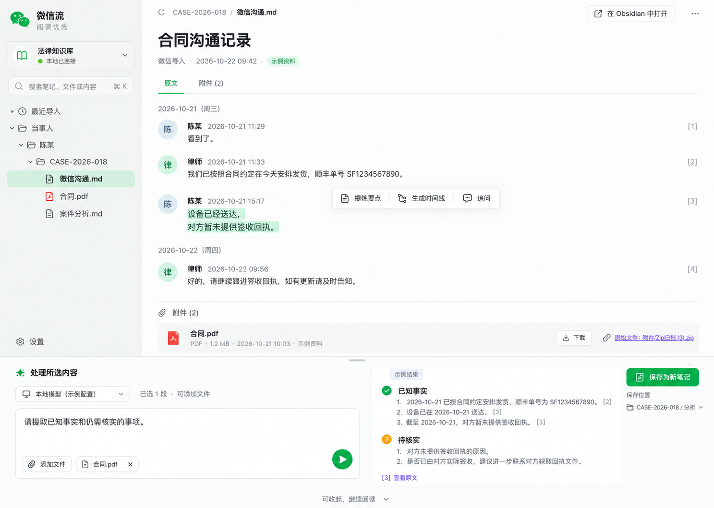

# 方案 3 · 阅读优先

## 目标与适用场景

以文档阅读为主，AI 在底部抽屉按需展开。 案例资料均为虚构，不能作为实际案件分析。

## 布局与交互

参考画布为 1488 × 1056。知识库目录 280 px；右侧文档自由伸展；下方 AI 抽屉约 300 px，可收起。

主流程：阅读原文 → 选中文段 → 提炼要点 / 时间线 / 追问 → 核对来源 → 另存笔记。

主要控件：阅读当前笔记、选择片段、附件列表、展开/收起处理区、处理范围提示、来源回跳。

沿用 Windows `Themes/AppTheme.xaml` 的灰绿底色、白色面板和绿色主操作。文字使用 Microsoft YaHei UI / Segoe UI；图标使用项目现有 Windows 图标字体。保留键盘焦点与独立滚动区域，窄窗口以折叠/滚动方式保持按钮可达。

## 具体实现方法

1. 在原生 WPF 客户端添加知识工作台入口，通过共享工作台状态持有库路径、文件清单、当前文件、选材、提示词和分析草稿。
2. 独立布局组件只组织视图，不各自读写知识库。目录发现、Markdown 读取、来源定位和新笔记保存均调用统一 Core 服务。
3. 使用现有 `ObsidianSettingsStore` 读取配置；支持显式选择本地目录。未连接与无文件时显示可操作的空状态；示例与真实库分别标注。
4. 将明确选中的文本与文件名组织为处理请求。通过当前可用的 AI Agent 工作流处理；外部返回的答案粘贴到可编辑草稿区，核对后另存。示例结果必须标为演示，不冒充真实模型输出。
5. 保存按钮始终展示目标相对路径；只创建新 Markdown 笔记，含输入来源、处理指令和草稿。文件已存在时不覆盖；原始 ZIP 和附件不修改。

## 组件边界

- 平台：`windows/src/WeChatBridge.Windows/` 的工作台 UI。
- 共享文件逻辑：`windows/src/WeChatBridge.Windows.Core/Obsidian/`。
- 原生客户端以外的平台实现不在本次交付内；macOS 可复用本说明与参考稿，需另做 SwiftUI 适配。
- 本次沿用现有 AI Agent 转发方式；在应用内直接配置供应商 API、流式响应和自动回传属于后续独立任务，不能把本地示例称作已经接入模型。

## 验收

- 切换到此方案时保留当前文件、选材、提示词与草稿。
- 能连接真实库、找到 Markdown 文件、读取正文、查看相关附件与来源位置。
- 处理请求只包含用户选定内容，空范围无法发送；草稿可粘贴与编辑。
- 点击来源能够回到原文；结果能另存为新笔记，显示成功或具体失败原因。
- 检查空库、失效路径、超大文件、取消操作、重名笔记、目录越界与符号链接。
- GitHub Actions 构建 Windows 的 Perpetual / Subscription 两形态，运行 Core/界面测试与现有无网络门禁；保留原生截图用于视觉复核。

## 低成本模型执行说明

执行模型：`gpt-6-luna`；按方案 3 → 2 → 1 串行。每阶段复用已落地 Core 与状态，不重新生成共享基础设施。编码任务与复核任务分离；高层检查真实可用性、安全保存与 CI，而非仅检查文件存在。
