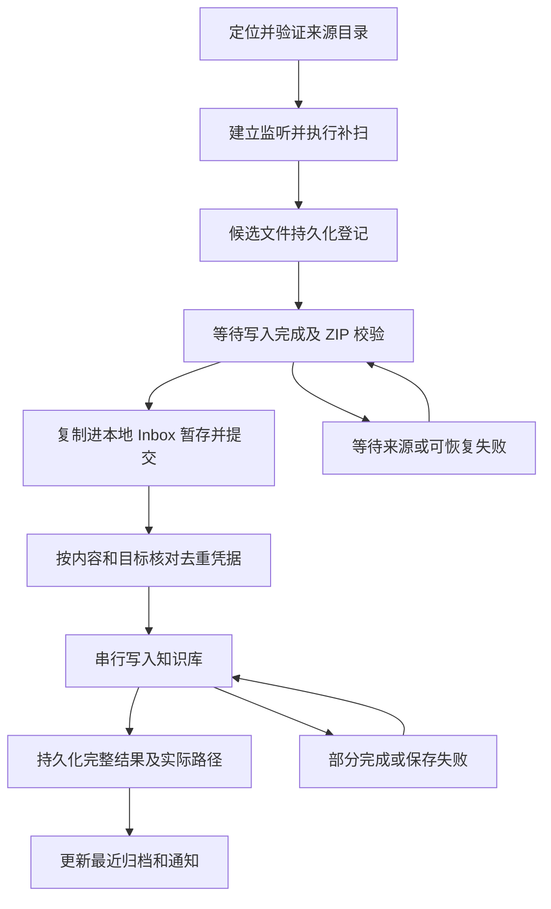

# WorkBuddy 自动检测与可靠归档详细设计

- 日期：2026-10-26
- 状态：待实现的设计规格；“现状”来自当前源码，“设计”属于后续工作。
- 适用范围：当前 Windows 用户下，WorkBuddy 本地聊天导出目录到 Obsidian 的单向归档。
- 界面契约：[Windows 精简桌面端](windows-minimal-desktop.zh-CN.md)。
- 源码核对：`0a3133e` 与最新远程 `main` 的 `4190f38`；目录监听和导入锁现状一致，归档描述以主线已加入附件分类及提取告警的实现为准。

## 1. 目标与检测边界

正常使用只要求用户选择知识库。来源目录自动定位、检查、监听和恢复，路径异常时才提供手动覆盖。

此处“自动检测”指本地来源和归档条件的检测，不是 WorkBuddy API 对接。当前链路不需要账号、登录态、端口、Token、数据库解密参数或微信进程注入。

区分三种证据：

| 证据 | 可以得出的结论 | 不能得出的结论 |
| --- | --- | --- |
| 检测到来源目录且可读取 | 该路径可作为候选来源 | WorkBuddy 已安装、正在运行或将继续写这里 |
| 成功建立监听并完成目录扫描 | 本产品已准备接收该目录变化 | 微信转发链路已经验证 |
| 真实聊天 ZIP 成功生成笔记及必需附件 | 该次端到端归档成功 | 将来所有归档必然成功 |

WorkBuddy 是否安装、进程是否运行不作为硬门禁；目录可用时直接接收。目录缺失也不能断言“未安装 WorkBuddy”。首期不扫描全盘、不枚举其他用户、不猜测安装目录里的账号配置。

## 2. 当前源码事实与缺口

| 位置 | 当前事实 | 本设计要求 |
| --- | --- | --- |
| `Services/WorkBuddyArchiveWatcher.cs` | 用当前用户目录拼接 `.workbuddy/app/tmp/chat-history` | 保留默认规则，增加覆盖路径和结构化检测 |
| Watcher 构造函数 | `Directory.CreateDirectory` 主动创建来源目录 | 检测不创建来源目录，缺失时等待真实目录出现 |
| Watcher 初始化 | 已有 ZIP 全部加入内存 `_known` | 使用持久化起点和任务凭据，支持运行后停机期间补收 |
| Watcher 事件 | 监听 Created / Renamed；内部错误回调日志 | 增加重扫、重建和退避，覆盖事件丢失 |
| 文件稳定等待 | 750ms 轮询、最多 40 次，尝试独占读 | 保留稳定检查，但超时须记录并允许继续检查 |
| Watcher `_known` | 导入回调之前已标记，且仅保存在内存 | 暂存 / 成功必须由持久化任务状态确认 |
| `MainViewModel.LocalImport.cs` | `_isImporting` 为 true 时直接 return | 后台事件进入可靠队列，不得因 UI 忙而丢弃 |
| 归档失败分支 | Toast 后可能继续显示泛用“已导入，发给…” | 持久化失败，移除多出口和覆盖失败的提示 |
| `KnowledgeDelivery.cs` | 返回笔记路径；已分类存储附件并将提取告警写入笔记，但返回值仍未区分完整 / 降级 | 返回完整结果，区分已保存、部分完成和失败 |
| `KnowledgeDelivery.cs` | 笔记原子写入，ZIP 和媒体另行写入 | 补齐跨文件归档事务与中断恢复，不能只靠笔记原子替换 |

现状参考：[目录来源调查](../exploration/windows-inbox-ready-source.zh-CN.md)。该调查中的“只处理启动后新文件”描述历史实现，本设计的持久化补收是明确的行为变更。

## 3. 来源目录发现

### 3.1 解析顺序

1. 若 `WorkBuddyDirectoryOverride` 有值，使用该用户明确指定的绝对路径。
2. 否则使用 `Environment.SpecialFolder.UserProfile`，拼接 `.workbuddy/app/tmp/chat-history`。
3. 不存在时保持 `Missing`，等待目录出现；不得静默切换到其他相似目录。
4. 手动路径失效时保留配置并显示异常；用户点击“恢复自动检测”才清除覆盖值。

默认路径是当前项目的兼容约定，不宣称它是 WorkBuddy 对未来版本的官方承诺。来源目录改变后，由重新检测或手动覆盖恢复；未来增加候选路径必须附实际依据并补测试。

### 3.2 验证步骤与结果

解析为完整路径，检查目录存在，尝试枚举顶层文件并读取元数据，再尝试建立监听。来源验证是只读操作，不创建目录、文件或测试 ZIP，也不修改 WorkBuddy 数据。

| 状态 | 条件 | 后续行为 |
| --- | --- | --- |
| `Checking` | 正在验证 | UI 显示正在检查，不阻塞主线程 |
| `Missing` | 来源目录不存在 | 定时探测并提供重新检测 |
| `AccessDenied` | 枚举或读取权限不足 | 持续保留错误，允许手动指定 |
| `WatchUnavailable` | 目录可读但监听建立失败 | 尝试重建，不能仅凭可读显示正常接收 |
| `Ready` | 目录可读、监听建立、补扫完成 | 显示等待记录或正在接收 |

检测结果包含解析路径、来源模式（自动 / 手动）、状态、最近检查时间、错误码。完整异常写日志，主界面显示简明原因，不展示堆栈。

### 3.3 重试与目录变化

- 启动、恢复接收、保存来源设置和“重新检测”时立即检查。
- 目录缺失或监听故障时按 2、5、15、30 秒退避，之后每 30 秒检查一次；手动重新检测立即打断退避。
- 正常运行每 60 秒轻量补扫一次来源目录；解锁、系统从休眠恢复时立即重查并补扫。
- 监听 Error、缓冲区溢出、目录删除 / 重建或失去权限时置为非 Ready，销毁旧 watcher，重建后先扫描再恢复正常状态。
- 多次检测合并执行；同一时刻只有一个来源 watcher，不因设置多次保存重复注册回调。

## 4. 首次接收与补收规则

### 4.1 首次启用

来源首次验证可用后，在启用接收前完成一次顶层快照，并持久化“首次基线”和 `ReceptionStartedAtUtc`。快照内已经存在的 ZIP 默认标为历史基线，不自动导入，避免首次打开就灌入大量旧记录。

先建立 watcher 并缓冲事件，再枚举基线；扫描完成后处理缓冲事件并重新扫描。对同时出现在基线和缓冲事件里的路径，按启用边界和首次观察元数据判定；无法可靠区分的边界候选进入待检查，而不是静默当历史忽略。实现必须测试这一竞态。

若来源尚不存在，先保存启用时间；目录后来出现时，处理该时间之后的新 ZIP。启动时没有配置知识库则不启用接收，仅检测来源，避免无目标地复制聊天数据。

首期不增加“导入全部历史”按钮。基线排除必须在设置来源修复说明中可知：“首次启用不自动导入已有记录。”

### 4.2 后续启动、暂停与退出

同一来源恢复时不重新建立全量历史基线；扫描既有目录，排除首次历史基线与已成功凭据，恢复已暂存任务，并接收符合起点的未处理文件。

停机或暂停期间生成、且恢复时仍存在的文件会补收。目录相同但文件被覆盖后内容改变，应作为新候选处理，不能仅按路径过滤。

手动切换到一个从未使用的新来源时建立独立来源 ID 和首次基线；切回旧来源复用其状态。来源 ID 基于规范化路径及持久化来源记录，不依赖 WorkBuddy 的安装位置。

文件时间只能辅助快速筛选，不能单独当成功凭据或永久高水位。恢复原备份、系统时钟变化、时间戳粒度都不能导致已观察任务被遗忘。

### 4.3 补收的实际边界

只处理仍可访问的来源文件和本产品已暂存的副本。WorkBuddy 在应用未运行时生成又删除的文件无法恢复；不能承诺“退出期间绝不漏收”。因此默认启用开机后台运行，关闭窗口继续驻留。

## 5. 监听、暂存与队列

### 5.1 事件接入

Created、Renamed 和必要的 Changed 事件，以及定期扫描，都只登记候选任务，不在 UI 线程执行 ZIP 读取或笔记生成。同一路径同一指纹的事件合并。

采用持久化任务登记加单消费者队列。唤醒通知可以合并，持久化任务不能丢；内存队列达到容量后依然保留任务，并在下一轮从持久化状态补载。主窗口打开与否不影响服务。

候选快速指纹由规范化路径、长度、最后写入时间构成，只用于事件去抖。完成暂存后使用实际内容 SHA-256 做最终身份判断；哈希计算使用流，不能新增整包内存复制。

### 5.2 文件准备

沿用 750ms 稳定采样：至少连续两次大小和最后写入时间相同、非空，并能以独占读方式打开。稳定后复制到本产品暂存区，再校验暂存副本 ZIP 结构可读，计算内容哈希。

复制前后核对来源指纹；发现变化则丢弃本次未提交副本并重试。沿用已有单文件 1 GiB 等 Inbox 限制及归档安全检查，不绕过校验。

约 30 秒仍不稳定时记录“等待源文件写入完成”，保留任务；后续事件或补扫继续检查，不静默结束。稳定但 ZIP 无效时等待最多两轮补扫确认，仍无效则标记“源文件无效”，提供重新检查。

来源在暂存前消失则标记“源文件已移走，等待重新导出”；不显示“原始文件已保留”。只有副本提交成功后才能这样提示。重试已暂存任务只使用本产品副本，不再依赖 WorkBuddy 原文件。

### 5.3 任务状态

| 内部状态 | 持久化事实 | UI 结果 |
| --- | --- | --- |
| `Observed` / `WaitingForSource` | 路径、指纹、来源 ID、首次观察时间 | 等待源文件 |
| `Staging` | 暂存开始，尚未原子提交 | 正在接收 |
| `Staged` / `Queued` | Inbox 副本已提交并绑定批次 | 等待保存 |
| `Archiving` | 目标快照与写入事务 ID 已记录 | 正在保存 |
| `Succeeded` | 笔记、ZIP、必需附件及结果均提交 | 已保存 |
| `Partial` | 可用产物已提交，但解析或媒体有缺失 | 部分完成 |
| `Failed` | 可恢复错误与当前可用副本位置已记录 | 保存失败 / 接收失败 |
| `Duplicate` | 内容及目标已有成功凭据 | 关联已有结果，不新增重复行 |

重试使用原任务 ID 和 Inbox 批次，不反复创建同一记录。暂停不是每个任务的失败状态；已登记任务留在当前可恢复状态。

## 6. 去重、持久化与中断恢复

### 6.1 记录布局与职责

建议在现有 `AppLayout` 派生的数据根下新增 `WorkBuddyReception/`，遵循安装版 / 便携版路径规则，不硬编码系统盘：

- `sources.json`：来源 ID、路径、首次启用时间、首次历史基线。
- `jobs/<jobId>.json`：任务状态、来源元数据、内容哈希、Inbox 批次、目标快照、重试信息、结果和错误。
- `receipts/<receiptId>.json`：成功去重凭据、实际目标路径、内容哈希和结果校验信息。
- 归档事务临时数据存放在受目标路径约束的事务目录；重启按 journal 恢复。

JSON 采用同目录临时文件加原子替换，任务先落盘再通知 UI；单实例服务串行更新。临时 JSON 残留可清理，未知或损坏正式记录必须隔离并报错，不能当作“从未处理”批量重放。

这些是新增内部状态，不直接扩展现有跨平台 manifest/state 枚举。UI 通过投影读取，成功结果继续兼容已有 `delivered / Obsidian`；新部分完成细节先由接收任务记录承载。

### 6.2 去重语义

最终去重键为“ZIP 内容 SHA-256 + 规范化知识库路径 + 子文件夹”。同样字节在同一目标成功归档后不重复写入；同群的新内容仍正常归档。内容哈希只能阻止整包重复，聊天消息合并继续使用已有会话笔记逻辑，不宣称能对任意不同 ZIP 实现消息级完全去重。

成功凭据只有在产物提交完成后写入。失败、部分完成、仅观察到或仅暂存都不能占用成功去重键。成功收据已存在但目标丢失时，不自动重建用户可能主动删除的内容；提示位置变化，用户明确重试后再恢复。

首次基线需要保存轻量文件指纹；同一路径的大小或时间改变时重新检查，不能永久按文件名忽略。对基线中长期未变的历史文件不承诺发现刻意保留相同大小和时间戳的内容替换。

### 6.3 跨文件提交

笔记、原 ZIP 和媒体是多文件产物，操作系统不能一次原子提交全部。以事务 journal 记录计划路径、文件哈希、旧笔记哈希、提交进度：

1. 创建事务并准备本次所需副本与笔记临时文件，持久化计划。
2. 先提交原 ZIP 和必需附件，再提交引用它们的笔记；所有实际最终名称先确定并写入计划。
3. 合并现有笔记前核对读取时的哈希；被 Obsidian 或用户改动则重新读取合并，避免覆盖外部修改。短时冲突重试后仍冲突则保留可恢复失败。
4. 所有必需项成功后提交任务结果和收据；部分解析 / 媒体失败则提交 Partial，写明已存在产物。
5. 重启检查未完成 journal，根据文件哈希与计划对账，补齐缺项或继续收尾，不重新分配带数字后缀的另一套文件。

重试 Partial 时复用已提交产物，合并或修复原笔记，不能靠重复调用当前 `Deliver` 就宣称幂等。已人工修改内容无法自动安全合并时，保留原内容并形成明确失败供用户处理。

以上目标是“可恢复且避免重复”，不声称跨 WorkBuddy、Inbox 与知识库的严格分布式 exactly-once。

### 6.4 启动恢复顺序

先迁移并加载配置，再读取来源与任务，恢复未完成事务，重建队列；随后建立监听并补扫。非终态任务不会因来源目录缺失而消失：有 Inbox 副本的任务仍可归档。

本地成功缓存默认保留 30 天；只在产物完整性核验后清理。失败和 Partial 副本、未完成 journal 不自动清理。轻量成功收据保留以支持长期去重，不跟随历史列表的展示期限删除。

## 7. 知识库校验与目标绑定

- 根目录必须存在且用户可写；不自动创建丢失的根目录，避免移动硬盘断开后写到错误位置。
- 子目录必须是知识库内的相对路径；拒绝绝对路径、`..`、解析后越界及指向库外的重解析路径。
- 用独立短生命周期临时文件验证写入，清理失败也记录诊断；不能把“能读取目录”当作可写。
- Obsidian 可执行文件或协议缺失只影响打开操作，不阻断文件归档。
- 每条任务在接收时绑定目标快照；未配置目标不启用接收。设置变化只影响后续任务，已有任务不静默改投。
- 用户对失败任务明确选择“使用当前保存位置”时，更新该任务目标快照和去重键，保留旧尝试记录；不自动搬迁已有部分产物。

`KnowledgeDelivery` 的结果契约应包含：笔记实际路径、原包路径、提取附件、解析状态、警告、事务 ID。必须用这些结果判定完整 / 部分完成并实现“打开笔记”。

继续复用主线附件分类及 `附件/原始归档` 的输出布局、原生聊天文字识别和归档安全校验，不因简化界面而退回旧的附件平铺实现。

## 8. 配置与运行状态契约

### 8.1 配置字段（设计新增）

| 字段 | 规则 |
| --- | --- |
| `SchemaVersion` | 递增，配置只迁移一次，保留迁移备份 |
| `ObsidianVaultPath` / `ObsidianSubfolder` | 沿用现有字段；新用户子目录“微信聊天”，旧值保留 |
| `WorkBuddyDirectoryOverride` | 可空；空表示当前用户默认路径 |
| `ReceptionPaused` | 新用户 false；暂停后持久化 |
| `NotifyOnArchiveSuccess` | 新用户 true |
| `LaunchAtLogin` | 沿用当前偏好 |

检测时间、队列长度、错误和最近成功不混入用户偏好：检测结果在运行状态中，任务与成功事实在接收账本中。

`settings.json` 是目标配置真相；`obsidian.json` 为兼容投影。保存时先验证、原子提交主配置，再生成投影；投影失败时保留待同步标记并阻止依赖旧投影的调用。启动时按主配置修复投影。升级时主配置未设置目标但投影有有效旧目标，可一次性导入并记录来源；不来回覆盖。

### 8.2 UI 状态合成

服务分别提供 `SourceStatus`、`DestinationStatus`、`ReceptionPaused`、活动任务、待处理数和最近完整成功时间。主状态优先级：

1. 未配置知识库：选择保存位置。
2. 已暂停：已暂停接收；在次级说明保留来源 / 目标异常。
3. 目标不可写：无法保存到知识库；可继续暂存已发现来源，但受磁盘检查约束。
4. 来源不可用：等待来源 / 无法接收；有副本的队列任务仍可运行，在辅助说明呈现。
5. 正在处理：正在保存。
6. 正常空闲：未经真实归档验证显示等待记录；有成功事实显示正在接收。

最近一次端到端成功仅由 Succeeded 更新，Partial 不更新。切换来源或目标后，验证事实按当前组合重新计算，不能借用旧组合的成功来宣称新链路已验证。

## 9. 错误与重试策略

| 错误 | 用户文案 | 自动行为 / 用户动作 |
| --- | --- | --- |
| 来源缺失 | 等待 WorkBuddy 导出聊天记录 | 退避探测；重新检测 / 手动指定 |
| 来源无权限 | 无法读取聊天记录目录 | 保留路径，权限恢复后重查 |
| 监听失败 / 缓冲溢出 | 接收暂时中断，正在恢复 | 重建并补扫，恢复后清除运行错误 |
| 写入仍在进行 | 等待源文件写入完成 | 保留任务，后续补扫检查 |
| 来源提前消失 | 源文件已移走，请重新导出 | 不假称保留副本，任务留在列表 |
| ZIP 稳定后仍无效 | 聊天记录文件无法读取 | 有限复查后等待手动重新检查 |
| 超过导入大小限制 | 聊天记录文件过大，请分批转发 | 不反复复制或自动重试 |
| 知识库不可写 / 已断开 | 无法保存到知识库，已接收记录已保留 | 修复目标后恢复，前提是副本确已提交 |
| 磁盘空间不足 | 空间不足，暂时无法保存聊天记录 | 停止复制，保留任务和所有既有副本 |
| 文件占用 / 短暂 I/O 错误 | 保存暂时失败，正在重试 | 2、5、15 秒自动尝试，仍失败转手动重试 |
| 解析降级 | 原始记录已保存，部分内容未能转换 | 标记 Partial，允许重试原批次 |
| 笔记外部修改冲突 | 笔记已被修改，暂时无法合并 | 有限重新合并后保留失败，不覆盖用户内容 |

人工“重试”也必须经过幂等和目标校验。任何分支都不回退到“发给其他应用”、剪贴板或普通导出文件夹。

## 10. 实现拆分

| 模块（建议名称） | 职责 |
| --- | --- |
| `WorkBuddySourceResolver` | 自动 / 手动路径解析，不产生文件系统写入 |
| `WorkBuddySourceProbe` | 来源状态、监听能力及权限检查 |
| `WorkBuddyReceptionService` | 生命周期、退避、补扫、事件去抖和暂停 |
| `ReceptionJobStore` | 来源基线、持久化任务、收据及原子写入 |
| `ArchiveQueue` | 单消费者调度、稳定等待、Inbox 暂存及取消恢复 |
| `KnowledgeDelivery` 扩展 | 归档 journal、合并冲突、完整与部分结果 |
| `ReceptionStatusViewModel` | 状态聚合及 UI 投影，不承担文件复制 |

以上名称为建议，不强制增加对应数量的类。先围绕可替换的文件系统、时钟和写入器划分接口，避免为了模块表拆出重复框架。

## 11. 验收与验证计划

| 编号 | 场景 | 必须满足 |
| --- | --- | --- |
| WB-01 | 默认路径存在 | 自动定位并建立监听，无参数输入 |
| WB-02 | 默认路径缺失 | 不创建 WorkBuddy 目录，不宣称未安装或已连接 |
| WB-03 | 手动来源及恢复自动 | 路径优先级正确，只有一个 watcher，新来源使用独立基线 |
| WB-04 | 文件缓慢写入 / 改名完成 | 完整后才暂存，超时可继续检查 |
| WB-05 | 一次连续导出 10 个 ZIP | 全部登记、串行保存，不受 `_isImporting` 丢弃 |
| WB-06 | 重复事件与重复 ZIP | 同一目标只产生一次成功结果，无重复笔记和通知 |
| WB-07 | 首次已有历史 | 历史不自动灌入；扫描与事件交错的新文件不漏 |
| WB-08 | 暂停 / 停机后恢复 | 起点之后且仍存在的记录被补收，旧成功记录不重放 |
| WB-09 | 来源目录删除重建 / watcher 溢出 | 状态降级、重建、补扫后恢复 |
| WB-10 | 来源与目标权限变化 / 磁盘满 | 状态诚实，已暂存副本保留，无成功误报 |
| WB-11 | 在暂存、附件提交、笔记提交、收据前后强制退出 | 重启对账恢复，任务不丢，不生成另一套后缀文件 |
| WB-12 | 同名会话不同内容 / 外部编辑笔记 | 正常合并或明确失败，不覆盖用户并发修改 |
| WB-13 | 文字 / 媒体解析降级 | Partial 持久化，可重试复用产物，不更新完整成功时间 |
| WB-14 | 切换知识库及配置投影中断 | 队列不静默改投，启动修复投影，历史不自动重导 |
| WB-15 | 清理成功缓存 | 失败与 Partial 副本不删，成功收据仍可去重，知识库文件不删 |
| WB-16 | 实际微信 → WorkBuddy → 知识库 | 至少完成一次真实转发，验证 Markdown、原包、图片引用及打开笔记 |

单元与临时目录集成验证覆盖状态机、并发事件、故障注入、迁移和路径约束；真实桌面验证覆盖微信转发、休眠恢复及移动盘场景。只检查目录存在、运行测试替身或成功创建 watcher，均不能替代 WB-16。

本次仅提交设计，以上测试和真实链路验收尚未执行。
